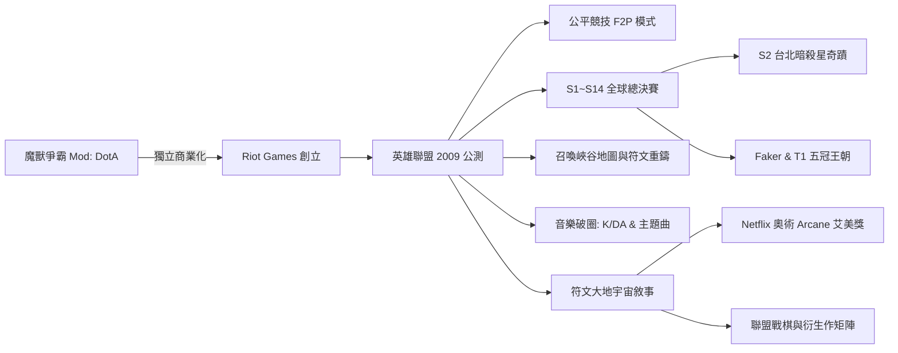

# 英雄聯盟發展史知識庫 (LLM Wiki) - 目錄與總覽

歡迎查閱「英雄聯盟發展史」結構化知識庫。本知識庫是利用 LLM Wiki 模式建立的本體知識庫，經由 5 篇核心歷史技術文獻（Raw Ingestion）提煉、交叉驗證與概念圖譜構建而成。

---

## 📚 原始文獻庫 (Raw Ingested Data)
1. [文獻 01：英雄聯盟的起源與誕生 (2006 - 2009)](../raw/01_origins_and_birth_2006_2009.md)
   * *核心知識點*：DotA Allstars 脈絡、Riot Games 創辦願景（GaaS 模式）、取消反截小兵機制、40 位初始英雄、免費遊玩商業破局。
2. [文獻 02：召喚峽谷地圖演進與核心遊戲機制革新](../raw/02_gameplay_evolution_and_map_redesign.md)
   * *核心知識點*：2014 地圖視覺重塑、S8 符文重鑄（移除舊符文數值門檻）、元素飛龍與峽谷地形變換、預示者滾雪球機制、神話裝備興衰與回歸。
3. [文獻 03：電競王朝與全球總決賽 (Worlds) 傳奇](../raw/03_esports_phenomenon_and_worlds.md)
   * *核心知識點*：S1 瑞典地下室轉播、S2 台北暗殺星 (TPA) 黑馬奪冠、大魔王 Faker 與 T1 五冠神話、AR 巨龍與鳥巢體育館視覺革命。
4. [文獻 04：商業模式創新、音樂行銷與玩家社群文化](../raw/04_business_model_and_player_culture.md)
   * *核心知識點*：No Pay-to-Win 公平競技付費哲學、虛擬樂團（Pentakill、K/DA）、世界大賽年度主題曲流行破圈、快樂風男與 200 年迷因。
5. [文獻 05：符文大地宇宙與 IP 全面擴張 (奧術、衍生作與未來)](../raw/05_ip_expansion_and_future_universe.md)
   * *核心知識點*：從召喚師到符文大地（Retcon 宇宙重塑）、Netflix 動畫《奧術》艾美獎歷史紀錄、戰棋 TFT 與手遊激鬥峽谷矩陣、未來 MMORPG 願景。

---

## 🧠 結構化合成專題 (Synthesized Knowledge Hubs)
* 📖 [**英雄聯盟 2006-2026 二十年演進編年史**](core_timeline.md)
  * 將二十年歷史劃分為五大時代：開拓創世紀、職業聯賽奠基期、視覺與機制大重鑄期、IP 與跨界破圈期、全方位宇宙成熟期。
* ⚙️ [**遊戲設計哲學與底層機制演進**](game_mechanics_evolution.md)
  * 深度解析「降低上手負擔」、「提高戰略博弈」、「保持公平競技」三大設計心法。
* 🏆 [**全球電競生態與流行文化衝擊**](cultural_and_esports_impact.md)
  * 剖析賽事體系如何成為體育商業典範，以及音樂與動畫如何重塑遊戲 IP 價值。

---

## 🔗 知識庫概念關聯網 (Knowledge Graph Relations)

