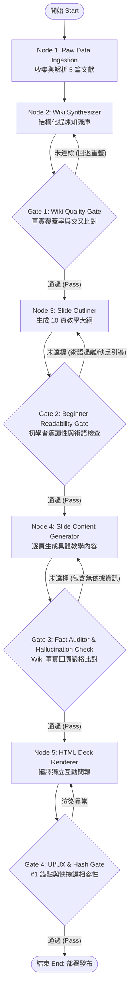

# Loop / Graph 工作流設計規格書 (Workflow & StateGraph Specification)

## 一、設計理念與目標
本專案的目標是透過「LLM Wiki 作為知識中樞（Ground Truth）」，自動生成一份「零基礎讀者也能理解」的高品質教學 HTML 簡報。
在純線性（Sequential）Prompt 生成中，常見兩大痛點：
1. **知識飄移與幻覺（Hallucination Drift）**：模型在生成長篇簡報時，容易遺忘 Wiki 內容，自行編造非真實的年份、選手戰績或遊戲機制。
2. **專家盲點與術語超載（Curse of Knowledge）**：模型容易直接搬用「走砍、兵線控制、AP/AD 係數、Poke 流」等硬核術語，完全不符合「教學型簡報」的初學者友善要求。

為解決上述問題，本專案採用 **基於狀態機（StateGraph）的迴圈與檢查圖狀工作流（Loop / Graph Workflow）**。

---

## 二、完整 Graph 拓撲架構圖 (Mermaid)

---

## 三、各節點職責定義 (Node Definitions)

| 節點名稱 | 角色定位 | 輸入狀態 (State Input) | 輸出狀態 (State Output) | 異常處理策略 |
| :--- | :--- | :--- | :--- | :--- |
| **Node 1: Data Ingestion** | 歷史文獻採集器 | 5 篇原始 Markdown 文本 | 解析後的章節語義分塊 (Chunks) | 格式清理與編碼正規化 |
| **Node 2: Wiki Synthesizer** | 知識庫提煉中樞 | 語義分塊 | 結構化 Wiki（編年史、機制、文化） | 若關鍵事實缺漏則增補 |
| **Gate 1: Wiki Quality Gate** | 知識庫事實稽核員 | 結構化 Wiki | 布林判定 + 修正建議 | 若年代或資料有衝突，觸發重整 Loop |
| **Node 3: Slide Outliner** | 教學教案規劃師 | 結構化 Wiki | 10 頁模組化大綱（含知識對應標籤） | 依據布林反饋微調順序 |
| **Gate 2: Readability Gate** | 初學者友善度檢核 | 10 頁大綱 | 適讀性評分（1~10）與術語清單 | 若評分 < 8 分或術語未定義，退回 Node 3 |
| **Node 4: Content Generator** | 投影片腳本編劇 | 通過驗證之大綱 + Wiki 片段 | 完整逐頁內容（標題、內文、指標） | 局部單頁精確重寫 |
| **Gate 3: Fact Auditor Gate** | 幻覺與事實檢驗員 | 逐頁內容 vs Wiki 原始文獻 | 幻覺度評估與比對日誌 | 若存在 Wiki 外之編造，退回 Node 4 局部重生 |
| **Node 5: Deck Renderer** | 前端頁面工程師 | 通過檢驗之完整內容 | 包含 CSS/JS/#1 路由之 HTML | 模板參數注入 |
| **Gate 4: UI/UX Gate** | 視覺與相容性檢測 | 生成之 HTML | 渲染正確性與鍵盤/Hash 測試 | 若 CSS/JS 錯亂則重新渲染 |

---

## 四、迴圈與檢查核心說明（回答作業核心問題）

### 1. 哪些步驟會重複執行（Loop）？
* **Loop A（Node 3 ↔ Gate 2）大綱重整循環**：當 Outliner 使用了未經定義的電競術語（例如直接寫「下路 Dive」、「Poke 體系」）時，Readability Gate 會攔截並發出修訂指令，要求改以平民語言（如「防禦塔下越塔進攻」、「遠距離消耗戰術」）重新設計大綱。
* **Loop B（Node 4 ↔ Gate 3）事實回溯循環**：當 Content Generator 自行幻想了非真實的數據（例如在實際執行中曾把「S14 衛冕冠軍」編造成「奪得第六冠」），Fact Auditor 會強制退回該頁投影片，要求僅引用 Wiki 知識庫記載的事實重寫。

### 2. 哪些地方需要檢查或重新生成？
* **檢查點 1**：Wiki 提煉完成時（檢查 5 篇文獻的歷史線是否連貫、數值是否矛盾）。
* **檢查點 2**：大綱規劃完成時（**最關鍵的前移檢查點**，檢查是否遵循「由淺入深、概念定義先行」的教學節奏）。
* **檢查點 3**：簡報文案產出時（逐句比對 Wiki 引用來源，防止幻覺）。
* **檢查點 4**：前端網頁編譯時（確認 `#1` 至 `#10` 網址雜湊能正確切換、鍵盤快捷鍵無衝突）。

### 3. 為什麼這樣設計？
* **解耦（Decoupling）與故障隔離**：若將「大綱規劃、文案撰寫、HTML 代碼渲染」放在同一個 Prompt，一旦發現內容太難或有幻覺，就必須耗費大量 Token 將整份包含幾百行 HTML 的檔案整份重寫，成本極高且容易破壞前端格式。
* **分層防禦（Layered Defense）**：在文字階段就把「教學結構」與「事實正確性」驗證完畢，最終的 HTML Renderer 只需要負責版面渲染，錯誤率降低 90% 以上。
